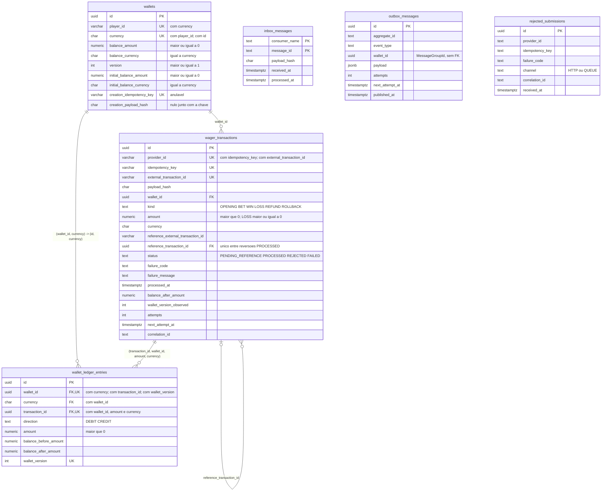

# Modelo de dados

O schema que as migrations do serviço produzem, e as invariantes que ele garante
sozinho, sem depender do código. Escrito a partir do catálogo do PostgreSQL
(`pg_constraint`, `pg_indexes`, `pg_trigger`) depois de aplicar as migrations
`0001`–`0014` num banco limpo pelo runner Bun (`bun run db:migrate up`), e
conferido na volta (`down` deixa só a tabela de controle do MikroORM).

As migrations ficam em `src/<módulo>/infrastructure/migrations/`.

Por que as invariantes moram no schema: [ADR 0001](adr/0001-mikroorm-7-com-invariantes-no-schema.md).
Versão da carteira como sequência do livro-razão: [ADR 0003](adr/0003-versao-da-carteira-como-sequencia-do-livro-razao.md).
Termos do domínio: [`CONTEXT.md`](../CONTEXT.md).

## Diagrama

Colunas-chave e todas as chaves estrangeiras. `UK` marca coluna que participa de
uma unicidade; o nome dela está na [tabela de invariantes](#invariantes).

`inbox_messages`, `outbox_messages` e `rejected_submissions` não têm chave
estrangeira de propósito: a inbox registra a mensagem antes de existir transação,
a outbox carrega o `wallet_id` só como `MessageGroupId`, e a auditoria guarda
submissões que nunca viraram transação. A tabela `mikro_orm_migrations` é do
runner, não do modelo, e fica fora do diagrama.

## Invariantes

Cada linha traz o nome exato no banco e a migration que o cria. Uma violação de
`UNIQUE` chega ao app como SQLSTATE `23505` com esse nome; a de `CHECK`, como
`23514`; a de FK, como `23503`; a de trigger, como `23000` com o prefixo da
mensagem indicado. O destino de cada uma está em
[Classificação de falhas](../ARCHITECTURE.md#classificação-de-falhas).

### Unicidade

| Invariante | Nome no banco | Tipo | Tabela | Migration | No classificador (`23505`) |
|---|---|---|---|---|---|
| Uma carteira por jogador e moeda | `wallets_player_currency_unique` | `UNIQUE (player_id, currency)` | `wallets` | 0001 | conflito `WALLET_ALREADY_EXISTS` |
| `(id, currency)` como alvo da FK de moeda do livro-razão | `wallets_id_currency_unique` | `UNIQUE (id, currency)` | `wallets` | 0001 | não mapeado (`INFRA_UNEXPECTED`) — só colidiria junto com a PK |
| `(id, wallet_id, amount, currency)` como alvo da FK de termos do livro-razão | `wager_transactions_ledger_terms_unique` | `UNIQUE (id, wallet_id, amount, currency)` | `wager_transactions` | 0013 | não mapeado (`INFRA_UNEXPECTED`) — só colidiria junto com a PK |
| Chave de criação idempotente da carteira | `wallets_creation_idempotency_key_unique` | `UNIQUE (creation_idempotency_key)`, anulável | `wallets` | 0012 | releitura da chave de criação |
| Uma transação por chave de idempotência do provedor | `wager_transactions_provider_idempotency_key_unique` | `UNIQUE (provider_id, idempotency_key)` | `wager_transactions` | 0005 | releitura da chave da transação |
| Um id externo por provedor | `wager_transactions_provider_external_id_unique` | `UNIQUE (provider_id, external_transaction_id)` | `wager_transactions` | 0005 | conflito `EXTERNAL_ID_CONFLICT` |
| Uma reversão processada por referência | `wager_transactions_single_reversal_unique` | índice único parcial em `reference_transaction_id` `WHERE status = 'PROCESSED' AND kind IN ('REFUND', 'ROLLBACK')` | `wager_transactions` | 0009 | `INFRA_INVARIANT_VIOLATION` |
| Um lançamento por transação e carteira | `wallet_ledger_entries_transaction_wallet_unique` | `UNIQUE (transaction_id, wallet_id)` | `wallet_ledger_entries` | 0003 | `INFRA_INVARIANT_VIOLATION` |
| Um lançamento por versão da carteira | `wallet_ledger_entries_wallet_version_unique` | `UNIQUE (wallet_id, wallet_version)` | `wallet_ledger_entries` | 0003 | `INFRA_INVARIANT_VIOLATION` |
| Uma entrega por consumidor e mensagem (inbox) | `inbox_messages_pkey` | `PRIMARY KEY (consumer_name, message_id)` | `inbox_messages` | 0010 | reentrega (confirma a mensagem) |
| Chaves substitutas | `wallets_pkey`, `wager_transactions_pkey`, `wallet_ledger_entries_pkey`, `outbox_messages_pkey`, `rejected_submissions_pkey` | `PRIMARY KEY (id)`, UUID | cada uma | 0001, 0002, 0003, 0007, 0006 | não mapeadas (`INFRA_UNEXPECTED`) |

### Chaves estrangeiras

| Invariante | Nome no banco | Definição | Migration |
|---|---|---|---|
| Toda transação pertence a uma carteira | `wager_transactions_wallet_fk` | `wager_transactions (wallet_id)` → `wallets (id)` | 0002 |
| A referência resolvida aponta para uma transação existente | `wager_transactions_reference_fk` | `wager_transactions (reference_transaction_id)` → `wager_transactions (id)` | 0008 |
| Todo lançamento pertence a uma transação | `wallet_ledger_entries_transaction_fk` | `wallet_ledger_entries (transaction_id)` → `wager_transactions (id)`, checada no commit | 0003, 0014 |
| Lançamento na moeda da carteira | `wallet_ledger_entries_wallet_currency_fk` | `wallet_ledger_entries (wallet_id, currency)` → `wallets (id, currency)` | 0003 |
| Lançamento com a carteira, o valor e a moeda da sua transação | `wallet_ledger_entries_transaction_terms_fk` | `wallet_ledger_entries (transaction_id, wallet_id, amount, currency)` → `wager_transactions (id, wallet_id, amount, currency)`, checada no commit | 0013, 0014 |

### `CHECK`s

| Invariante | Nome no banco | Expressão | Tabela | Migration |
|---|---|---|---|---|
| Moeda em três letras maiúsculas | `wallets_currency_format` | `currency ~ '^[A-Z]{3}$'` | `wallets` | 0001 |
| Saldo não negativo | `wallets_balance_non_negative` | `balance_amount >= 0` | `wallets` | 0001 |
| Versão a partir de 1 | `wallets_version_positive` | `version >= 1` | `wallets` | 0001 |
| Moeda repetida do saldo | `wallets_balance_currency_matches` | `currency = balance_currency` | `wallets` | 0001 |
| Saldo inicial não negativo | `wallets_initial_balance_non_negative` | `initial_balance_amount >= 0` | `wallets` | 0012 |
| Moeda repetida do saldo inicial | `wallets_initial_balance_currency_matches` | `currency = initial_balance_currency` | `wallets` | 0012 |
| Chave e hash da criação juntos | `wallets_creation_key_and_hash_together` | `(creation_idempotency_key IS NULL) = (creation_payload_hash IS NULL)` | `wallets` | 0012 |
| Valor positivo, exceto `LOSS` (que admite zero) | `wager_transactions_amount_positive` | `amount > 0 OR (kind = 'LOSS' AND amount >= 0)` | `wager_transactions` | 0002, refeito em 0005 |
| Tipos conhecidos | `wager_transactions_kind` | `kind IN ('OPENING', 'BET', 'WIN', 'LOSS', 'REFUND', 'ROLLBACK')` | `wager_transactions` | 0002 |
| Status conhecidos | `wager_transactions_status` | `status IN ('PENDING', 'PENDING_REFERENCE', 'PROCESSED', 'REJECTED', 'FAILED')` | `wager_transactions` | 0002 |
| `PENDING` nunca é gravado | `wager_transactions_not_pending` | `status <> 'PENDING'` | `wager_transactions` | 0005 |
| Coerência tipo × referência externa | `wager_transactions_reference_by_kind` | `WIN` livre; `OPENING`/`BET`/`LOSS` ⇒ nula; `REFUND`/`ROLLBACK` ⇒ preenchida | `wager_transactions` | 0005 |
| `PENDING_REFERENCE` só para quem referencia | `wager_transactions_pending_reference_kind` | `status <> 'PENDING_REFERENCE' OR kind IN ('WIN', 'REFUND', 'ROLLBACK')` | `wager_transactions` | 0005 |
| `PROCESSED` ⇔ `processed_at` | `wager_transactions_processed_at` | `(status = 'PROCESSED') = (processed_at IS NOT NULL)` | `wager_transactions` | 0005 |
| `REJECTED`/`FAILED` ⇔ `failure_code` | `wager_transactions_failure_code` | `(status IN ('REJECTED', 'FAILED')) = (failure_code IS NOT NULL)` | `wager_transactions` | 0005 |
| `PROCESSED`/`REJECTED` ⇔ saldo e versão observados | `wager_transactions_observed_balance` | `balance_after_amount`, `balance_after_currency` e `wallet_version_observed` todos preenchidos nesses status e todos nulos nos demais | `wager_transactions` | 0005 |
| `failure_message` só com `failure_code` | `wager_transactions_failure_message` | `failure_message IS NULL OR failure_code IS NOT NULL` | `wager_transactions` | 0008 |
| Tentativas não negativas | `wager_transactions_attempts_non_negative` | `attempts >= 0` | `wager_transactions` | 0011 |
| Pendente sempre agendada | `wager_transactions_pending_reference_schedule` | `status <> 'PENDING_REFERENCE' OR next_attempt_at IS NOT NULL` | `wager_transactions` | 0011 |
| Direções conhecidas | `wallet_ledger_entries_direction` | `direction IN ('DEBIT', 'CREDIT')` | `wallet_ledger_entries` | 0003 |
| Valor do lançamento positivo | `wallet_ledger_entries_amount_positive` | `amount > 0` | `wallet_ledger_entries` | 0003 |
| Moeda repetida do lançamento | `wallet_ledger_entries_currency_matches` | `currency = balance_before_currency AND currency = balance_after_currency` | `wallet_ledger_entries` | 0003 |
| Aritmética do lançamento | `wallet_ledger_entries_arithmetic` | saldos `>= 0` e `balance_after = balance_before ± amount` conforme a `direction` | `wallet_ledger_entries` | 0003 |
| Versão do lançamento a partir de 1 | `wallet_ledger_entries_version_positive` | `wallet_version >= 1` | `wallet_ledger_entries` | 0003 |
| Identificadores da inbox não vazios | `inbox_messages_consumer_name_not_empty`, `inbox_messages_message_id_not_empty` | `consumer_name <> ''`, `message_id <> ''` | `inbox_messages` | 0010 |
| Tentativas da outbox não negativas | `outbox_messages_attempts_non_negative` | `attempts >= 0` | `outbox_messages` | 0007 |
| Canal da submissão não admitida | `rejected_submissions_channel` | `channel IN ('HTTP', 'QUEUE')` | `rejected_submissions` | 0006 |

`NOT NULL` não tem nome: as colunas obrigatórias estão nas migrations. Destaques
que a seção do `ARCHITECTURE.md` cita: `wager_transactions.wallet_id` e
`correlation_id`, `outbox_messages.wallet_id`, e em `rejected_submissions` só
`failure_code`, `channel` e `received_at` (mais a PK).

**Saldo máximo:** sem `CHECK` próprio — o tipo `numeric(19, 2)` recusa o valor
acima de `99999999999999999.99` com `22003`. Ver
[Invariantes no schema](../ARCHITECTURE.md#invariantes-no-schema).

### Índices parciais de trabalho

| Uso | Nome no banco | Definição | Migration |
|---|---|---|---|
| Fila das pendentes por vencimento | `wager_transactions_pending_reference_next_attempt_idx` | `(next_attempt_at) WHERE status = 'PENDING_REFERENCE'` | 0011 |
| Fila da outbox por vencimento | `outbox_messages_pending_next_attempt_idx` | `(next_attempt_at) WHERE published_at IS NULL` | 0007 |

### Triggers

Todos recusam com SQLSTATE `23000` (`integrity_constraint_violation`), que o
classificador trata como `INFRA_INVARIANT_VIOLATION`; o prefixo da mensagem diz
qual regra caiu.

| Invariante | Trigger (função) | Quando | Prefixo da mensagem | Migration |
|---|---|---|---|---|
| Livro-razão imutável | `wallet_ledger_entries_immutable` e `wallet_ledger_entries_immutable_truncate` (`wallet_ledger_entries_reject_change`) | `BEFORE UPDATE OR DELETE` por linha; `BEFORE TRUNCATE` por comando | `wallet_ledger_entries_immutable` | 0003 |
| Saldo ↔ livro-razão: toda mudança de saldo tem o lançamento do saldo antigo ao novo na versão nova; a versão sobe exatamente 1 quando o saldo muda e não muda sem ele; carteira nasce na versão 1 | `wallets_balance_ledger` (`wallets_check_balance_ledger`) | *constraint trigger* `AFTER INSERT OR UPDATE`, `DEFERRABLE INITIALLY DEFERRED` — roda no commit | `wallets_balance_ledger_mismatch` | 0003 |
| Identidade da carteira imutável: `id`, `player_id`, `currency`, saldo inicial e chave e hash da criação | `wallets_identity_immutable` (`wallets_reject_identity_change`) | `BEFORE UPDATE` | `wallets_identity_immutable` | 0004, função ampliada em 0012 |
| Transação terminal imutável: só linha em `PENDING_REFERENCE` aceita `UPDATE`; a identidade (chave, hash, valor, tipo, carteira, `correlation_id`…) não muda; nada é apagado | `wager_transactions_guard` e `wager_transactions_guard_truncate` (`wager_transactions_guard_change`) | `BEFORE UPDATE OR DELETE` por linha; `BEFORE TRUNCATE` por comando | `wager_transactions_terminal_immutable`, `wager_transactions_identity_immutable`, `wager_transactions_immutable` (apagar) | 0005 |
| Lançamento só de transação aplicada e na direção do tipo: transação `PROCESSED` e não `LOSS`; `BET` ⇒ `DEBIT`; `OPENING`, `WIN`, `REFUND` ⇒ `CREDIT`; `ROLLBACK` ⇒ inverso do lançamento da referência, que precisa existir | `wallet_ledger_entries_transaction_coherence` (`wallet_ledger_entries_check_transaction`) | *constraint trigger* `AFTER INSERT`, `DEFERRABLE INITIALLY DEFERRED` — roda no commit (o worker de pendentes pode atualizar a transação depois do lançamento) | `wallet_ledger_entries_transaction_coherence` | 0013 |
| Nenhum lançamento sem a mudança de saldo: no commit, a carteira está numa versão ≥ à do lançamento e o lançamento de maior versão termina no saldo dela (a volta do `wallets_balance_ledger`) | `wallet_ledger_entries_balance_applied` (`wallet_ledger_entries_check_balance_applied`) | *constraint trigger* `AFTER INSERT`, `DEFERRABLE INITIALLY DEFERRED` — roda no commit | `wallet_ledger_entries_balance_applied` | 0013 |
| Auditoria append-only | `rejected_submissions_append_only` e `rejected_submissions_append_only_truncate` (`rejected_submissions_reject_change`) | `BEFORE UPDATE OR DELETE` por linha; `BEFORE TRUNCATE` por comando | `rejected_submissions_append_only` | 0006 |

## Conferência com o `ARCHITECTURE.md` e o classificador

- Toda garantia listada em [Invariantes no schema](../ARCHITECTURE.md#invariantes-no-schema)
  existe nas migrations com a forma descrita. Nenhuma divergência.
- Os oito nomes que o classificador de erros (`src/database/classify-database-error.ts`)
  mapeia para o `23505` existem no banco com esse nome exato. As unicidades fora
  do mapa — as PKs `uuid` e `wallets_id_currency_unique` — caem em
  `INFRA_UNEXPECTED`; nenhuma delas é colisão que o fluxo normal produza.
- **Lacuna, não divergência:** a moeda de `wager_transactions` não é amarrada à
  da carteira pelo schema — `currency` e `balance_after_currency` não têm `CHECK`
  nem FK composta, ao contrário do livro-razão. Quem garante é o domínio
  (`CURRENCY_MISMATCH`, em `src/wagering/domain/wallet-coherence.ts`); o
  lançamento, que é o que move saldo, segue amarrado por
  `wallet_ledger_entries_wallet_currency_fk`. Nenhum texto afirma o contrário,
  e a migration não muda aqui.
